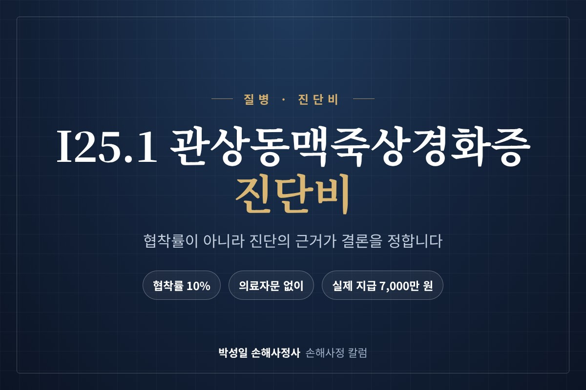
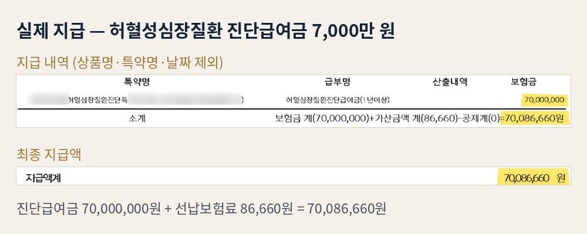

제목: I25.1 관상동맥죽상경화증 진단비, 협착률 10%로 거절된 건이 의료자문 없이 7,000만 원 전액 지급된 이유
날짜: 2026-11-12
분야: 질병·진단비
요약: 관상동맥 협착률이 10%라는 이유로 "의미 있는 허혈성 심장질환이 아니다"라는 안내를 받은 I25.1 건입니다. 약관에 없는 50% 기준이 어디서 나왔는지, 주치의 추가 소견서에 무엇을 담았는지, 그리고 별도 의료자문 없이 허혈성심장질환 진단급여금 7,000만 원이 전액 지급된 과정을 정리했습니다.
---

I25.1 관상동맥죽상경화증 진단비는 협착률이 50%에 못 미쳐도 받을 수 있습니다. 약관이 요구하는 것은 **협착의 정도가 아니라 의사의 확정 진단과 그 근거**이기 때문입니다.

실제로 협착률이 **10%**에 불과하다는 이유로 거절 안내를 받았던 건이, 주치의 추가 소견서를 근거로 **별도 의료자문 없이 7,000만 원 전액** 지급됐습니다. 숫자 하나에 막혔던 건이 어떻게 정리됐는지 차례로 설명드리겠습니다.

## 협착률 10%, 보험사가 본 숫자와 약관이 본 문장

이 건의 의뢰인은 흉통으로 검사를 받았고, 관상동맥조영술 판독에서 죽상경화 병변이 확인돼 주치의로부터 **I25.1** 진단을 받았습니다.

보험사의 답은 짧았습니다. 관상동맥 협착률이 50% 미만, 그것도 10% 수준이라 **의미 있는 허혈성 심장질환으로 보기 어렵다**는 것이었습니다.

보험사가 본 것은 '10%'라는 숫자였습니다. 그런데 약관이 정해 둔 것은 숫자가 아니라 문장입니다. 허혈성심장질환 진단비 약관은 대체로 **의사가 병력과 검사 결과를 종합해 진단을 확정한 경우**를 지급 사유로 정해 두고 있습니다. 협착률이 몇 % 이상이어야 한다는 조건은 적혀 있지 않습니다.

## I25.1은 어떤 질병을 담고 있나

한국표준질병사인분류(KCD)에서 I25는 **만성 허혈성 심장병**입니다. 그 안의 I25.1 **죽상경화성 심장병**에는 관상동맥 죽상경화증, 관상동맥의 죽종과 경화증, 관상동맥질환이 함께 포함돼 있습니다.

허혈성심장질환 진단비 약관의 분류표는 대부분 I20~I25를 보장 대상으로 묶어 둡니다. 따라서 I25.1로 확정 진단을 받았다면, 코드만 놓고 보면 **약관 분류표 안에 있는 질병**입니다. 다만 상품마다 분류표 범위가 다를 수 있으니, 가입한 약관의 분류표는 꼭 직접 확인하셔야 합니다.

관상동맥죽상경화증이라는 병명 자체가 I25.1 안에 명시돼 있다는 점도 기억해 두실 만합니다. 쟁점은 결국 하나입니다. 코드가 분류표에 들어 있는데도, 협착이 적다는 이유로 그 진단을 인정하지 않을 수 있느냐입니다.

## 50%는 어디서 나온 숫자인가

50%는 임상에서 '폐쇄성' 관상동맥질환, 즉 혈류에 영향을 줄 만큼 좁아졌는지를 가르는 기준으로 흔히 쓰이는 숫자입니다. 시술을 고민할지, 약물로 관리할지를 판단하는 데 쓰입니다.

치료 방침을 정하는 숫자이지, **질병이 있느냐 없느냐를 가르는 숫자는 아닙니다.** 50% 미만이라는 것은 아직 시술할 단계가 아니라는 뜻이지, 혈관에 병변이 없다는 뜻이 아닙니다.

심장 CT 판독에 쓰는 국제 기준(CAD-RADS)도 같은 방식으로 나눕니다.

- **0** — 협착·플라크 없음
- **1** — 1~24%, 최소 협착(minimal)
- **2** — 25~49%, 경도 협착(mild)
- **3 이상** — 50% 이상, 중등도 이상 협착

10% 협착은 이 기준에서도 '질환 없음(0)'이 아니라 '최소 협착(1)'에 들어갑니다. 협착이 적다는 것과 병변이 없다는 것은 다른 이야기입니다.

## 실제 지급: 협착률 10%, 진단급여금 7,000만 원

이 건은 보험사의 의료자문으로 넘어가기 전에, **주치의의 판단을 더 구체적으로 문서화**하는 쪽을 택했습니다. 진단서 한 장에 담기지 않은 진단의 근거를 주치의 추가 소견서로 정리해 함께 제출했습니다.

결과는 **별도 의료자문 없이 진단급여금 7,000만 원 전액**, 선납보험료 86,660원이 더해져 **70,086,660원**이 지급됐습니다. 협착률 10%라는 숫자는 바뀌지 않았습니다. 바뀐 것은 그 숫자를 둘러싼 진단 근거가 문서로 정리됐다는 점입니다.

지급 내역의 급부명에는 **'1년이상'**이 붙어 있습니다. 가입 후 1년이 지나 감액 없이 가입금액 전액이 지급됐다는 뜻입니다.

## 주치의 추가 소견서에 담은 네 가지

진단서에는 병명과 코드만 적힙니다. 그래서 "협착이 적은데 왜 이 진단인가"라는 질문에 답하려면, 주치의가 진단에 이른 이유를 따로 받아 두어야 합니다. 이 건의 추가 소견서에는 네 가지를 담았습니다.

- **흉통의 원인** — 내원 당시 호소한 흉통과 관상동맥 병변의 관계
- **조영술 판독 소견** — 협착 수치뿐 아니라 죽상경화 병변이 실제로 관찰됐다는 사실
- **처방된 치료제의 의학적 이유** — 약물치료를 시작한 것이 단순 관찰이 아니라 치료가 필요한 상태라는 판단에 따른 것이라는 점
- **향후 진행 위험** — 병변을 방치할 경우의 진행 가능성

네 가지가 한 문서에 정리되면, 협착률 하나로 진단 전체를 부정하기가 어려워집니다. 그 결과 보험사도 별도 의료자문을 진행하지 않고 지급을 결정했습니다.

## 보험사가 주로 드는 반론

**"50% 미만 협착은 나이가 들면 생기는 변화입니다."** 협착이 적다는 것은 병변의 정도가 가볍다는 뜻입니다. 주치의가 병변을 확인하고 진단을 확정해 약물치료까지 시작했다면, 이는 단순 노화가 아니라 **치료 대상인 질병**으로 판단했다는 기록입니다.

**"스텐트 시술을 하지 않았습니다."** 진단비는 시술 여부가 아니라 진단 확정에 대해 지급하는 담보입니다. 약물로 관리하는 단계라고 해서 진단 자체가 사라지지는 않습니다.

**"심근허혈이 증명되지 않았습니다."** I25 안에는 경미한 관상동맥질환처럼 심근허혈과 직접 관련되지 않은 질병도 함께 들어 있습니다. 허혈 검사가 진단의 필수 조건이라는 문구는 약관에 없습니다.

## "의료자문 동의서를 달라고 하면요?"

보험사는 협착이 적은 건에서 의료자문을 진행하겠다며 동의서를 요청하는 경우가 많습니다. 자문의는 환자를 직접 진찰하지 않고, 제출된 기록만으로 답합니다.

그래서 순서가 중요합니다. 자문이 진행되기 전에 **주치의의 판단 근거부터 문서로 정리해 제출**하면, 이 건처럼 자문 없이 결론이 나기도 합니다. 동의 여부를 정하기 전에 어떤 자료로 무엇을 묻는지 범위부터 확인하시기 바랍니다.

## 법원은 이 쟁점을 어떻게 봤나

비슷한 쟁점을 다룬 하급심 판결이 있습니다. 울산지방법원 2019나1633 판결은 심근허혈이 확인되지 않았더라도, 약관이 정한 분류에 해당하는 I25.1 확정 진단을 받았다면 진단비 지급 사유가 된다고 봤습니다.

판결 하나로 모든 건의 결론이 정해지지는 않습니다. 다만 "협착이 적거나 허혈이 증명되지 않으면 진단비 대상이 아니다"라는 주장이 약관에서 바로 나오는 결론은 아니라는 점은 분명히 보여 줍니다.

## "건강검진에서 우연히 발견됐는데요?"

검진에서 발견된 경우도 청구할 수 있습니다. 다만 흉통이나 호흡곤란으로 내원한 경우보다 보험사의 반론이 더 강하게 들어오는 편입니다.

이럴 때는 진단 이후의 기록이 중요합니다. 추가 검사를 받았는지, 약을 처방받아 복용하고 있는지, 정기적으로 추적 관찰을 하고 있는지가 **치료가 필요한 질병**이라는 판단을 뒷받침합니다.

## 판독지에서 먼저 볼 표현

협착률 숫자만 보고 포기하기 전에, 판독지에 아래 표현이 있는지 확인해 보십시오. 숫자보다 이 표현들이 진단의 근거가 됩니다.

- **Atherosclerotic plaque, soft plaque, calcified plaque** — 혈관 벽에 죽상경화반이 실제로 있다는 기록
- **LAD, LCx, RCA** — 어느 혈관에 병변이 있는지, 여러 혈관에 걸쳐 있는지
- **Coronary calcium score(석회화 점수)** — 심장 CT를 찍었다면 함께 적히는 수치

협착이 10%든 20%든, 플라크가 관찰되고 이에 맞춰 약물치료가 시작됐다면 '아무 이상 없음'과는 분명히 다른 상태입니다.

## 진단비가 어려운 경우

- 진단서에 확정 진단이 아니라 **'의증(R/O)'**만 적힌 경우
- 판독지에 플라크나 협착 소견 없이 **정상(normal)**으로 적힌 경우
- 가입 후 **1년 이내** 진단으로 감액 기간에 해당하는 경우
- 가입 전 심장 관련 치료 이력이 있어 **고지의무**가 문제 되는 경우

이런 경우라면 상담에서도 실익이 없다고 그대로 말씀드립니다.

## 청구 전에 챙길 서류

- **관상동맥조영술 또는 심장 CT 판독지** — 협착 수치와 함께 플라크·죽상경화 표현 확인
- 진단서 (I25.1 확정 진단)
- 초진 기록 — 흉통 등 어떤 증상으로 내원했는지
- 약제 처방 내역 — 항혈소판제, 스타틴 등
- 주치의 추가 소견서 — 진단 근거와 치료 필요성

## 정리

I25.1 관상동맥죽상경화증 진단비는 **협착률이 아니라 진단의 근거**에서 결론이 납니다. 협착률 10%로 거절 안내를 받았던 건도, 주치의의 판단을 문서로 정리하자 의료자문 없이 7,000만 원 전액이 지급됐습니다.

협착이 적다는 이유로 거절 안내를 받으셨거나 의료자문 동의를 요청받으셨다면, 판독지와 진단서를 준비해 연락 주십시오. 어떤 근거를 먼저 정리해야 하는지 확인해 드립니다. 상담은 무료입니다. **전화 010-2754-1552** 또는 카카오톡으로 문의하실 수 있습니다.
