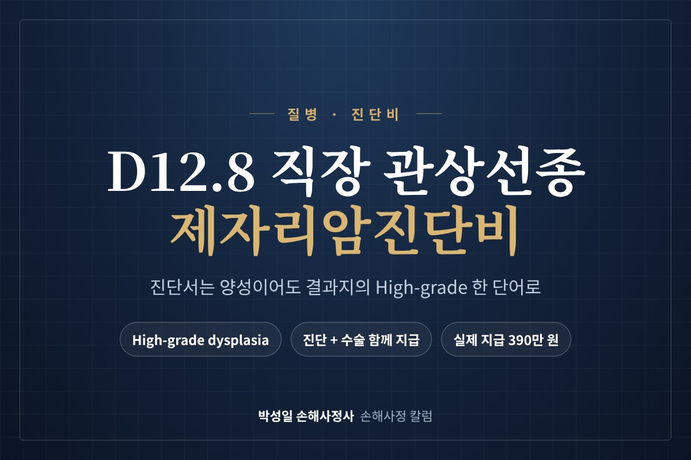
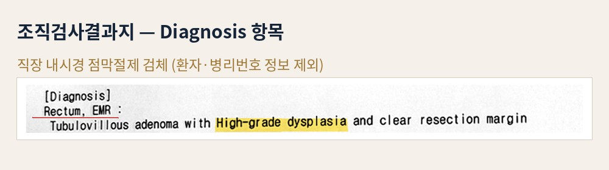
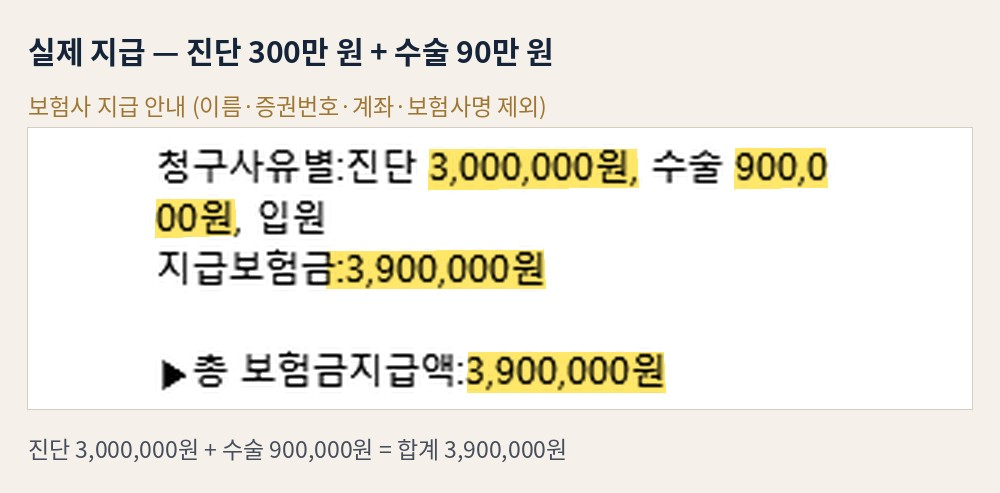

제목: D12.8 직장 관상선종 제자리암진단비, 진단서는 '양성'이어도 결과지 한 줄 'High-grade dysplasia'로 받은 진단·수술비
날짜: 2026-11-03
분야: 질병·진단비
요약: 직장 용종을 내시경으로 떼어내고 진단서에 D12.8 직장의 양성신생물이 적혔더라도, 조직검사결과지에 High-grade dysplasia(고등급 이형성)가 있으면 제자리암진단비를 청구할 수 있습니다. 결과지 한 줄을 네 조각으로 나눠 읽는 방법과, 실제로 진단비 300만 원과 수술비 90만 원이 지급된 과정을 정리했습니다.
---

대장내시경에서 떼어낸 직장 용종으로 진단서에 **D12.8 직장의 양성신생물**이 적혔더라도, 조직검사결과지에 **High-grade dysplasia(고등급 이형성)**가 있다면 제자리암진단비를 청구할 수 있습니다.

진단서 코드는 용종의 '종류'까지만 담고, 결론을 바꾸는 '등급'은 결과지에만 적혀 있기 때문입니다. 실제로 이 차이를 근거로 **진단비 300만 원과 수술비 90만 원**이 지급된 건을 바탕으로 설명드리겠습니다.

## 결과지 한 줄을 네 조각으로 나눠 읽기

이 건의 조직검사결과지 진단 항목입니다. 한 줄처럼 보이지만, 보험금 판단에 필요한 정보가 네 조각으로 나뉘어 들어 있습니다.

- **Rectum, EMR** — 부위는 직장, 검사 방법은 내시경 점막절제술입니다. 진단 코드의 부위가 여기서 정해집니다.
- **Tubulovillous adenoma** — 관상융모선종입니다. 관상선종에 융모 모양의 성분이 섞인 형태로, 용종의 '종류'를 말합니다.
- **with High-grade dysplasia** — 세포의 변형 정도가 높다는 뜻입니다. **이 조각이 결론을 바꿉니다.**
- **and clear resection margin** — 절제면에 병변이 남지 않았다는 뜻입니다. 치료가 깨끗하게 끝났다는 의미일 뿐, 분류와는 관계가 없습니다.

많은 분들이 첫 조각과 둘째 조각만 보고 "양성 용종이구나" 하고 넘어가십니다. 그런데 보험에서 확인해야 할 것은 셋째 조각입니다.

## 관상선종, 관상융모선종, 융모선종

대장·직장 선종은 현미경으로 본 모양에 따라 세 가지로 나뉩니다.

- **관상선종(Tubular adenoma)** — 가장 흔한 형태로, 관 모양의 샘 구조로 이루어져 있습니다.
- **관상융모선종(Tubulovillous adenoma)** — 관상선종에 융모 모양 구조가 섞인 형태입니다. 이 건이 여기에 해당합니다.
- **융모선종(Villous adenoma)** — 융모 모양 구조가 대부분인 형태입니다.

세 가지 모두 진단서에서는 같은 '양성신생물' 코드로 적히는 경우가 많습니다. 보험 판단에서 중요한 것은 이 모양 분류가 아니라, 그 뒤에 붙는 **이형성의 등급**입니다.

## 진단서 D12.8이 담지 못한 것

D12.8은 '직장의 양성신생물'이라는 뜻입니다. 선종이라는 종류만 보면 틀린 코드는 아닙니다. 병원에서는 내시경으로 떼어낸 선종에 관행적으로 이 코드를 붙이는 경우가 많습니다.

문제는 이 코드에 **'고등급'이라는 정보가 들어 있지 않다는 점**입니다. 진단서만 제출하면 보험사는 양성 용종으로 보고, 수술비 정도만 검토한 채 끝낼 수 있습니다.

그래서 이 사안은 처음부터 진단서가 아니라 **결과지를 기준으로** 청구해야 합니다. 암보험 약관은 대체로 병리 전문의의 조직 소견을 진단 확정의 근거로 정해 두고 있습니다.

## 고등급 이형성은 어느 칸에 들어가나

직장 선종의 세포 변형은 크게 저등급과 고등급으로 나뉩니다. 이 한 단어가 보험에서는 칸을 바꿉니다.

- **Low-grade dysplasia (저등급)** — 양성 선종의 범위에 머뭅니다. 제자리암 주장이 어렵습니다.
- **High-grade dysplasia (고등급)** — 종양 형태분류에서 고등급 상피내 신생물과 같은 범주, 즉 행동양식 **/2(제자리)**로 연결됩니다.

행동양식이 /2이면 약관의 분류표에서는 **직장의 제자리암종** 쪽에 놓입니다. 그래서 제자리암진단비의 대상이 됩니다.

다만 결과지에 /2라는 부호가 직접 찍혀 나오지는 않습니다. 결과지의 진단명을 형태분류표에 대조해야 도출되는 값이고, 그 대조를 근거와 함께 정리하는 것이 검토의 핵심입니다.

## 결과지에서 '고등급'을 나타내는 표현들

병원마다 결과지 문구가 조금씩 다릅니다. 아래 표현 중 하나가 있으면 같은 고등급 소견으로 보고 검토할 수 있습니다.

- **High-grade dysplasia** (이 건의 표현)
- **High-grade intraepithelial neoplasia**
- **Carcinoma in situ**

'focal' 또는 'focally'라는 말이 앞에 붙어 있어도 마찬가지입니다. 선종 일부에서만 고등급 변형이 보였다는 뜻일 뿐, 고등급 소견이 확인됐다는 사실은 달라지지 않습니다.

## 실제 지급: 진단 300만 원 + 수술 90만 원

이 건은 진단서 코드만으로 청구했다면 양성 용종 기준으로 끝날 수 있는 건이었습니다. 그래서 결과지의 고등급 이형성 소견과 분류 근거를 정리해 제자리암진단비로 청구했습니다.

결과는 **진단 300만 원, 수술 90만 원, 합계 390만 원**입니다. 보험사 지급 안내의 처리병명도 '제자리(상피내)암종'으로 적혀 나왔습니다. 진단서는 D12.8 그대로였지만, 보험금은 결과지 기준으로 정리된 것입니다.

제자리암진단비는 일반암보다 가입금액이 작은 경우가 많습니다. 그래도 같은 결과지로 진단비와 수술비가 함께 나오고, 여러 보험에 가입돼 있다면 계약마다 따로 받을 수 있어 확인할 가치가 충분합니다.

## 보험사가 주로 드는 반론

**"진단서 코드가 D12.8, 양성입니다."** 출발점은 진단서 코드가 아니라 결과지의 병리 진단명입니다. 진단서 코드는 선종이라는 종류만 담고 있고, 등급 정보는 결과지에만 있습니다.

**"용종은 다 떼어냈고 남은 병변도 없습니다."** 절제면이 깨끗하다는 것은 치료가 잘 끝났다는 뜻입니다. 진단비는 치료 결과가 아니라 **무엇으로 진단이 확정됐는지**에 대해 지급되는 담보입니다.

**"고등급 이형성은 아직 암이 아니라 전암 단계입니다."** 맞는 말입니다. 그런데 제자리암은 원래 **암세포가 상피층을 넘어 퍼지기 전 단계**를 따로 정해 둔 담보입니다. 아직 침윤하지 않았다는 사실은 제자리암에서 벗어나는 이유가 아니라, 오히려 제자리암의 정의와 맞닿아 있습니다.

## "수술비는 왜 같이 나왔나요?"

가입한 상품에 따라 제자리암을 기준으로 지급하는 수술 담보가 따로 있는 경우가 있습니다. 분류가 제자리암으로 정리되면 같은 기준을 쓰는 담보도 함께 검토됩니다.

이 건도 진단과 수술이 같은 지급 안내에 함께 정리됐습니다. 청구할 때는 진단비 하나만 보지 말고, **증권에 있는 제자리암 관련 담보를 모두 확인**하시는 것이 좋습니다.

## "병원에서 진단서 코드를 못 바꿔 준대요"

바꾸지 않아도 됩니다. 병원은 진료 기준에 따라 선종에 D12.8을 붙이는 것이고, 무리하게 변경을 요청할 필요는 없습니다.

일부 보험사가 "진단서를 제자리암 코드로 바꿔 오라"고 안내하는 경우도 있습니다. 이때도 결론은 진단서 수정이 아니라 **결과지 소견과 분류 근거를 문서로 정리해 제출**하는 쪽으로 정리하는 것이 일반적입니다.

## 결과지는 어떻게 발급받나요?

조직검사결과지는 진단서와 별도로 발급받아야 합니다. 병원 의무기록 사본 발급 창구에서 **'조직검사결과지(병리판독지)'**를 따로 요청하시면 됩니다.

환자 본인이 가기 어려워 가족이 대신 발급받을 때는 **환자의 동의서와 위임장, 환자 및 방문하는 본인의 신분증**을 1부씩 챙기시면 됩니다. 병원마다 양식이 다를 수 있으니 미리 확인해 보십시오.

## 이미 수술비만 받고 끝났다면

다시 볼 수 있습니다. 수술비와 제자리암진단비는 서로 다른 담보이고, 보험금 청구권의 소멸시효는 **진단일로부터 3년**입니다.

수술비만 받으셨다면 결과지부터 꺼내 보십시오. High-grade가 적혀 있는데 진단비가 빠져 있다면, 그 부분을 따로 청구할 수 있습니다.

## 제자리암진단비가 어려운 경우

- 결과지에 **Low-grade dysplasia**만 적혀 있는 경우
- 결과지 없이 내시경 소견만 있는 경우
- 가입한 상품에 **제자리암 진단비 담보 자체가 없는** 경우
- 가입 직후 **면책기간이나 감액기간** 안에 진단받은 경우

이런 경우라면 상담에서도 실익이 없다고 그대로 말씀드립니다.

## 청구 전에 챙길 서류

- **조직검사결과지(병리판독지)** — Diagnosis 항목 전체
- 진단서 (D12.8이 적혀 있어도 그대로)
- 내시경 시술기록 또는 수술확인서
- 보험 증권 — 제자리암 진단·수술 담보 확인용
- 이미 받은 지급 안내문이 있다면 함께

## 정리

D12.8 직장 관상선종 제자리암진단비는 진단서 코드가 아니라 **결과지의 등급 한 단어**에서 결론이 납니다. 결과지를 네 조각으로 나눠 보고, 셋째 조각에 High-grade가 있는지부터 확인해 보십시오. 같은 용종이라도 결과지 문구 한 단어에 따라 수술비만 받고 끝날 수도, 진단비와 수술비를 함께 받을 수도 있습니다. D12.8 직장 관상선종 제자리암진단비 청구는 그 한 단어를 확인하는 데서 시작합니다.

용종을 떼어내고 수술비만 받으셨거나 아직 청구 전이라면, 결과지와 증권을 준비해 연락 주십시오. 어느 담보까지 청구할 수 있는지 확인해 드립니다. 상담은 무료입니다. **전화 010-2754-1552** 또는 카카오톡으로 문의하실 수 있습니다.
