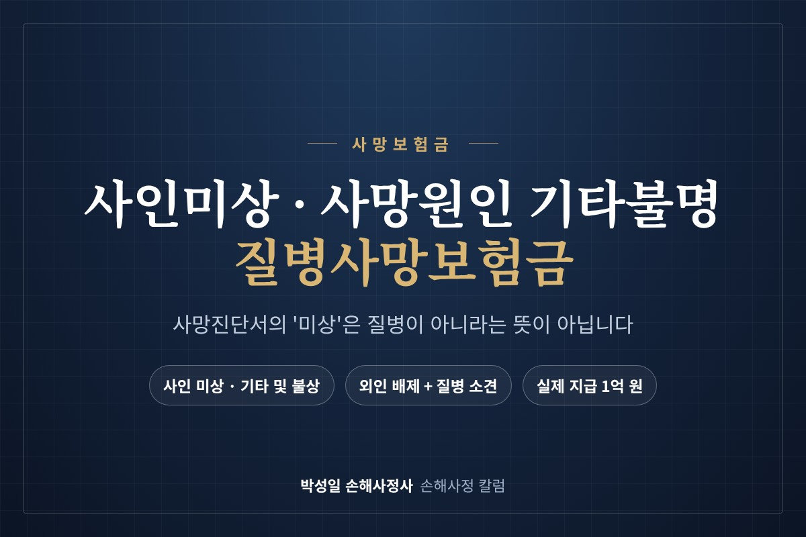
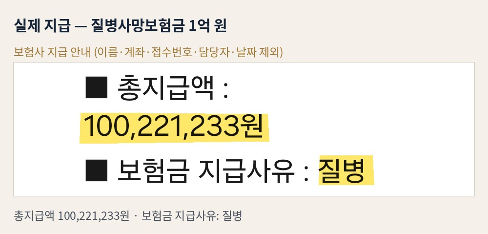

제목: 사인미상 사망원인 기타불명 질병사망보험금, 사망진단서에 '미상'이 적혀도 1억 원이 지급된 이유
날짜: 2026-11-27
분야: 질병·진단비
요약: 사망진단서에 직접사인 '미상', 사망의 종류 '기타 및 불상'이 적힌 사망 건에서 질병사망보험금 1억 원이 지급된 과정을 정리했습니다. 사인을 하나로 특정하기보다 외인을 배제하고 질병 소견을 쌓는 방식, 현장심사에서 유족이 주의할 점, 미리 확보할 기록을 함께 설명합니다.
---

사망진단서에 사인 '미상', 사망의 종류 '기타 및 불상'이 적혀 있어도 질병사망보험금을 받을 수 있습니다. 그 기재는 **원인을 확인할 시간이 없었다는 뜻이지, 질병이 아니라는 뜻이 아니기 때문**입니다.

실제로 이런 사망진단서가 발급된 건에서 질병사망보험금 **1억 원**이 지급됐습니다. 보험사가 어떤 지점을 볼지, 유족 쪽에서는 무엇을 먼저 정리해야 하는지 차례로 설명드리겠습니다.

## 사망진단서의 '미상'은 무엇을 뜻할까

집이나 길에서 쓰러진 채 발견돼 병원에 도착했을 때 이미 심정지 상태였다면, 병원은 사인을 확인할 검사를 할 시간이 거의 없습니다. 이럴 때 사망진단서에는 흔히 직접사인 **'미상'**, 사망의 종류 **'기타 및 불상'**이 적힙니다.

이 문구는 의사가 그 자리에서 사인을 단정할 근거가 부족했다는 기록입니다. 외부 원인이 있었다는 뜻도, 질병이 아니라는 뜻도 아닙니다.

반대로 이 문구만으로 질병사망이 자동으로 인정되지도 않습니다. 결국 진단서 밖의 기록으로 **사망에 이르기까지의 과정**을 설명해야 합니다.

## 질병사망, 상해사망, 일반사망의 차이

사망 관련 담보는 크게 세 가지로 나뉩니다. 사인이 미상일 때는 어떤 담보에 가입돼 있는지에 따라 다퉈야 할 지점이 달라집니다.

- **일반사망** — 원인을 묻지 않고 사망 자체에 지급합니다. 종신보험 등이 여기에 해당하며, 면책 사유만 아니면 사인 미상이라도 큰 문제가 되지 않습니다.
- **질병사망** — 질병으로 인한 사망에 지급합니다. 외부 원인이 없다는 점과 질병 소견이 쟁점이 됩니다.
- **상해사망** — 외부의 우연한 사고로 인한 사망에 지급합니다. 사고가 있었다는 점을 보여 줘야 합니다.

증권을 펼쳐 세 가지 중 무엇이 있는지부터 확인하십시오. 여러 담보가 함께 있다면, 사인미상 사망원인 기타불명 질병사망보험금 청구는 **사망 관련 담보 전체를 함께 청구**해 두는 것이 안전합니다.

## 보험사가 확인하려는 세 가지

사인이 미상인 사망 건에는 대부분 현장심사가 배정됩니다. 보험사가 확인하려는 것은 크게 세 가지입니다.

- **외부 원인이 있었는지** — 사고, 추락, 약물 중독 같은 외래 요인이 있었는지
- **스스로 해친 것은 아닌지** — 고의에 의한 사망이면 상해·질병 모두 면책될 수 있습니다
- **사인을 끝내 설명할 수 없는지** — 원인을 특정하지 못했다는 점을 부지급 근거로 삼을 수 있는지

세 가지 중 유족에게 가장 무거운 것은 두 번째입니다. 다만 고의에 의한 사망 같은 **면책 사유는 일반적으로 보험사가 입증**해야 하는 영역입니다.

## 누가 무엇을 입증해야 하나

질병으로 사망했다는 사실은 원칙적으로 **보험금을 청구하는 유족 쪽**에서 보여 줘야 합니다. 그렇다고 의학적으로 사인을 확진해야 한다는 뜻은 아닙니다.

외상이나 외부 원인의 흔적이 없고, 사망에 이를 만한 질병이 기록으로 확인되면 **정황을 종합해 질병사망으로 추단**하는 것이 실무의 흐름입니다. 반면 고의에 의한 사망처럼 보험금을 주지 않을 사유는 그것을 주장하는 보험사가 입증해야 합니다.

그래서 유족이 할 일은 사인을 하나로 맞히는 것이 아니라, **외부 원인이 없다는 점과 질병 소견이 있다는 점을 기록으로 보여 주는 것**입니다.

## 실제 사례: 사인 '미상'에서 질병사망 1억 원까지

이 건의 고인은 오랫동안 당뇨로 인슐린 치료를 받아 왔고, 천식도 함께 앓고 있었습니다. 어느 날 쓰러진 채 발견돼 119로 대학병원 응급실에 이송됐지만, 도착 당시 이미 심정지 상태였고 결국 사망이 선언됐습니다.

병원 사망진단서에는 직접사인 '미상', 사망의 종류 '기타 및 불상'이 적혔습니다. 이후 별도로 발급된 검안서에는 사망의 종류가 '병사'로 적혔지만, 그 안의 사인 설명과 응급실 검사 수치가 서로 다른 방향을 가리키는 부분도 있었습니다.

서류끼리 어긋나는 상황이었습니다. 이럴 때 어느 한 서류의 사인을 고집하면, 보험사는 그 서류의 신빙성부터 공격합니다.

의뢰를 받았을 때는 이미 보험사의 현장심사가 배정된 상태였습니다. 그래서 응급실 기록과 평소 진료기록을 먼저 확보해 검토하고, 구급활동일지와 변사 기록은 정보공개 청구를 걸어 두는 순서로 진행했습니다. 경찰 기록을 기다리느라 면담을 미루지 않은 것이 기간을 줄인 이유 중 하나입니다.

결과는 **질병사망보험금 1억 원**, 총지급액 **100,221,233원**입니다. 지급 안내의 지급사유에는 **'질병'**이 적혔습니다. 선임 후 2주 남짓 만에 지급이 결정됐습니다.

## 사인을 특정하지 않고, 외인을 배제하는 방식

이 건에서 택한 방식은 사인을 하나로 맞히려는 것이 아니었습니다. **외부 원인이 없다는 점**과 **사망에 이를 만한 질병 소견이 여러 개 있다는 점**을 나란히 정리하는 것이었습니다.

외인이 없다는 근거는 이랬습니다.

- 응급실 기록에 **외상흔 없음**이 명시돼 있었습니다
- 응급실 내원 사유가 **'질병'**으로 분류돼 있었습니다
- 혈당 수치가 약물을 과하게 투여했을 때의 방향과 맞지 않았습니다

질병 소견은 응급실 검사 결과에 이미 들어 있었습니다.

- 심장 기능 저하를 시사하는 **NT-proBNP 상승**과 흉부 사진상 **심비대**
- 오랜 당뇨와 연결되는 **신기능 저하**
- 혈액검사상 **심한 산증**
- 10년 가까운 **당뇨 치료 이력**과 인슐린 처방 기록

외인이 배제되고 질병 소견이 여러 갈래로 확인되면, 사인을 하나로 특정하지 못해도 **질병에 의한 사망으로 보는 것이 자연스러운 결론**이 됩니다.

## "보험사가 '약물 중독'이라고 하면요?"

인슐린을 쓰던 분이 사망하면 보험사가 인슐린 과다 투여를 의심하는 경우가 있습니다. 과다 투여를 외부 요인에 의한 중독으로 보면 질병이 아니라 상해 쪽 문제가 됩니다.

그런데 이 건처럼 상해사망 가입금액이 질병사망보다 큰 계약이라면, 보험사로서는 오히려 더 큰 금액을 인정해야 하는 논리가 됩니다. 또 평소 처방대로 투여한 약의 부작용은 중독이 아니라 **질병 치료 과정**에 가깝습니다.

그래서 처방 내역이 중요합니다. 처방량과 재처방 간격이 규칙적이었다는 기록은 평소대로 투여했다는 근거가 됩니다.

## "부검을 하지 않았는데 불리하지 않나요?"

부검을 하지 않았다는 사실만으로 유족에게 불리해지지는 않습니다. 변사 사건에서 부검 없이 시신이 인도됐다면, 수사기관이 **외부 원인의 혐의가 크지 않다고 판단했다**는 뜻일 수 있습니다.

이 판단은 경찰의 변사 처리 기록에 남습니다. 정보공개 청구로 일부를 확인할 수 있고, 외인을 배제하는 근거로 함께 쓸 수 있습니다.

## "보험사가 의료자문을 하자고 하면요?"

사인이 미상인 건에서는 보험사가 의료자문으로 '사인 불명'이라는 결론을 받아 두려는 경우가 있습니다. 자문의는 고인을 직접 본 적이 없고, 보험사가 보낸 기록만으로 답합니다.

동의 여부를 정하기 전에, **유족 쪽에서 먼저 기록을 정리해 제시**하는 것이 좋습니다. 누가 먼저 기록을 해석하느냐에 따라 같은 자료도 다르게 읽히기 때문입니다.

## 현장심사에서 유족이 주의할 점

현장심사에서는 조사자가 유족에게 고인의 생활과 사망 당일 상황을 묻습니다. 이때 몇 가지만 지키면 됩니다.

- **아는 사실만** 답하고, 모르는 것은 "잘 모르겠습니다"라고 말합니다
- "저혈당 때문인 것 같다", "약을 많이 맞은 것 같다"처럼 **사인을 추측하는 말**은 하지 않습니다
- 동의서·확인서는 그 자리에서 서명하지 말고, **의료자문 동의서**는 특히 신중하게 판단합니다
- 남은 약, 약 봉투, 처방전은 버리지 말고 보관합니다

사실을 감추라는 뜻이 아닙니다. 추측이 기록으로 남으면 그것이 사실처럼 쓰이기 때문입니다.

## 미리 확보할 기록

- 사망진단서 또는 시체검안서
- **응급실 기록 전체** — 초진·경과·간호기록, 검사결과, 영상 판독지
- 평소 다니던 병원의 **진료기록과 처방 내역**
- **구급활동일지** — 현장 상태와 처치 내용 (관할 소방서 정보공개 청구)
- 변사 처리 기록 — 경찰서 정보공개 청구로 일부 확인 가능
- 보험증권과 가입 당시 약관 — 사망 관련 담보 전체 확인

모든 자료가 다 필요한 것은 아닙니다. 응급실 기록과 평소 진료기록만으로도 방향이 잡히는 경우가 많습니다.

## 질병사망보험금이 어려운 경우

- 고의에 의한 사망으로 볼 만한 기록이 확인되는 경우
- 외부 사고의 흔적이 분명한데 상해사망 담보가 없는 경우
- 가입 후 얼마 되지 않아 **고지의무**가 문제 되는 경우
- 질병사망 담보 자체가 없거나 약관상 보장하지 않는 질병인 경우

이런 경우라면 상담에서도 그대로 말씀드립니다.

## 정리

사인미상 사망원인 기타불명 질병사망보험금은 **사인을 맞히는 싸움이 아니라, 외인을 배제하고 질병 소견을 쌓는 싸움**입니다. 사망진단서의 '미상' 한 줄에 청구를 포기하기 전에, 응급실 기록과 평소 진료기록부터 확인해 보십시오.

사망진단서와 보험증권, 보험사 안내 내용을 준비해 연락 주시면 어떤 기록부터 확보해야 하는지 확인해 드립니다. 상담은 무료입니다. **전화 010-2754-1552** 또는 카카오톡으로 문의하실 수 있습니다.
